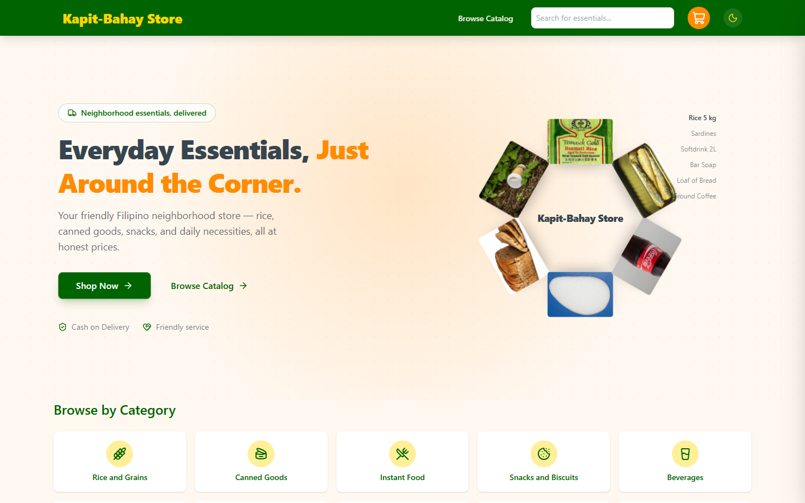

# Kapit-Bahay Store

> Everyday Essentials, Just Around the Corner. 🇵🇭

A mobile-first, frontend-only e-commerce storefront for a Filipino neighborhood variety store — rice, canned goods, snacks, and daily necessities, all at honest prices. Prices are in Philippine pesos (₱).



## Features

- **Works-wheel hero visual** — Interactive 3D product wheel that responds to scroll, drag, and arrow keys, with clickable items and reduced-motion support
- **Animated landing hero** — full-bleed, mouse-reactive hero with floating product imagery
- **Dark/Light theme** — User-toggleable theme persisted in localStorage, with theme-aware UI across all components
- **Category shortcuts** — quick jumps across 10 aisles (Rice & Grains, Canned Goods, Beverages, and more)
- **Product catalog** — browse, search, category filtering, and sorting, with a product detail view
- **Cart drawer** — add, adjust, and remove items; the cart persists in `localStorage`
- **Simulated checkout** — Cash on Delivery checkout flow with an order confirmation screen. Clearly labeled as a simulation: no real payments, backend, or fulfillment
- **Mobile-first responsive design** — Functional hamburger menu, mobile-optimized search and cart

## Tech Stack

- [React](https://react.dev) 19 + [TypeScript](https://www.typescriptlang.org) (strict mode)
- [Vite](https://vite.dev) with Tailwind CSS 4
- [Zustand](https://zustand.docs.pmnd.rs) for state management
- [Lucide](https://lucide.dev) icons

## Getting Started

```bash
npm install
npm run dev
```

Then open http://localhost:5173.

Other commands:

```bash
npm run build    # type-check with tsc and build for production
npm run preview  # preview the production build
npm run lint     # ESLint
```

## Deployment

To deploy a live preview, enable GitHub Pages for this repository on the `master` branch, or use any static hosting service (Netlify, Vercel, etc.) with the `dist` folder.

## Documentation

- Product scope: `docs/requirements/PROJECT-BRIEF.md`
- User stories: `docs/requirements/USER-STORIES.md`
- Acceptance criteria: `docs/requirements/ACCEPTANCE-CRITERIA.md`
- Architecture: `docs/architecture/SYSTEM-DESIGN.md`
- UI/UX direction: `docs/design/UI-UX-SPECIFICATION.md`
- Delivery plan: `docs/development/ROADMAP.md`
- Test strategy: `docs/development/TEST-PLAN.md`

## MVP Scope

This is a frontend-only SPA. There is intentionally no backend, database, real payment integration, authentication, admin dashboard, delivery tracking, or multi-branch support.
